<p align="center">
  
</p>

# 🌐 Awesome Social Media Scraping API 🚀

<a href="https://github.com/ishandutta2007/Awesome-Awesome-Awesome"></a><a href="https://discord.gg/jc4xtF58Ve"></a>
[](https://awesome.re)
[](https://github.com/ishandutta2007/Awesome-Social-Media-Scraping-API)
[](https://github.com/ishandutta2007/Awesome-Social-Media-Scraping-API/pulls)
[](https://opensource.org/licenses/MIT)
<a href="https://github.com/ishandutta2007"></a>

> **The definitive directory of high-performance SaaS social media scraping APIs, self-hosted web scrapers, residential proxy data unlockers, and open-source OSINT intelligence libraries.**

Curated with precision for software engineers, LLM data curators, quantitative researchers, threat intelligence analysts, and growth hackers building real-time data pipelines across **𝕏 (Twitter)**, **📸 Instagram**, **🎵 TikTok**, **▶️ YouTube**, **🤖 Reddit**, **💼 LinkedIn**, **🦋 Bluesky**, and **✈️ Telegram**.

---

## 📑 Table of Contents

- [📊 Sector Overview & Market Dynamics](#-sector-overview--market-dynamics)
- [🏢 Enterprise SaaS & Hosted Scraping APIs](#-enterprise-saas--hosted-scraping-apis)
  - [SaaS Solutions Comparison Matrix](#saas-solutions-comparison-matrix)
  - [Detailed SaaS Profiles](#detailed-saas-profiles)
- [💻 Open-Source GitHub Projects & Libraries](#-open-source-github-projects--libraries)
  - [Star-Ranked Repository Directory](#star-ranked-repository-directory)
  - [Detailed Open-Source Profiles](#detailed-open-source-profiles)
- [🛠️ Architecture Recommendations](#-architecture-recommendations)
- [🤝 How to Contribute](#-how-to-contribute)
- [💖 Support & Sponsorship](#-support--sponsorship)
- [📈 Star History](#-star-history)
- [⚖️ Disclaimer & Compliance](#️-disclaimer--compliance)

---

## 📊 Sector Overview & Market Dynamics

The global web data collection, proxy, and scraping services market is valued at **$1.56 billion** and is projected to expand to **$4.03+ billion** (growing at a **14% to 17% CAGR**), propelled by the exploding demand for real-time AI/LLM training datasets, competitive pricing analytics, and automated brand reputation monitoring.

The sector is **moderately fragmented**—while heavyweight infrastructure giants (*Bright Data* and *Oxylabs*) control dominant shares of large-enterprise proxy networks and data unlocker pipelines, the application and social scraper layer remains competitive and distributed. Specialized API providers (such as *Apify*, *Decodo*, *Sorsa API*, *EnsembleData*, and *ScraperAPI*) thrive alongside a vibrant open-source ecosystem by solving niche bot challenges, platform-specific GraphQL endpoints, and custom developer workflows.

---

## 🏢 Enterprise SaaS & Hosted Scraping APIs

Enterprise hosted APIs eliminate the overhead of residential proxy pool rotation, fingerprint masking (TLS/JA3/JA4, Canvas, WebGL), CAPTCHA solving, and session-cookie regeneration.

### SaaS Solutions Comparison Matrix

Sorted in **descending order by company scale** (estimated valuation or annual recurring revenue):

| 🏢 Platform | 💰 Valuation / Scale (ARR) | 💵 Starting Tier Pricing | 🎁 Free Tier / Free Trial Limits | 🎯 Target Platforms & Highlights |
| :--- | :--- | :--- | :--- | :--- |
| **[Oxylabs](https://oxylabs.io)** | **$3.6B Valuation** ($350M ARR) | **$49 / month** (Micro Plan: ~17.5K–98K requests) | **Free Trial with custom test credits upon signup** (Success-based billing) | Enterprise Web Scraper API, Residential IPs, automated CAPTCHA bypass |
| **[Bright Data](https://brightdata.com)** | **>$300M ARR** (Market Leader) | **$8.40 / 1K requests** (Pay-as-you-go) or **$499 / month** | **5,000 free credits / month forever** (~$7.50 recurring credit balance) | Social Media Scraper API, Web Unlocker, 72M+ residential proxy network |
| **[Decodo (formerly Smartproxy)](https://decodo.com)** | **$100M+ Scale** (Part of *Source*) | **$19 / month** (Starter plan) or **$3.75 / GB** | **Free Starter Plan with $5 testing credits** (~2,000–10,000 requests, no CC) | Dedicated Social Media Scraping API for Instagram, TikTok, X, & YouTube |
| **[Apify](https://apify.com)** | **$13.3M+ ARR** (~80% YoY Growth) | **$19 / month** (Starter plan, includes $19 credits) | **$5.00 recurring free platform credits every month forever** (No CC) | Cloud Actor marketplace: Instagram, TikTok, LinkedIn, Facebook, X crawlers |
| **[ScraperAPI](https://scraperapi.com)** | **$5M+ ARR** (Multi-million ARR) | **$19 / month** (Hobby: 10,000 credits) or **$49 / month** (100K credits) | **7-day free trial with 5,000 credits**; plus **1,000 credits / month forever** | Turnkey REST API handling headless Chrome, IP rotation, and CAPTCHA solving |
| **[EnsembleData](https://ensembledata.com)** | **$2M+ Scale** (Bootstrapped / Profitable) | **$100 / month** (Wood Plan: 1,500 daily units) | **Free trial with 50 units / day** (No CC required) | Real-time social data API for TikTok, Instagram, YouTube, Threads, and Twitch |
| **[Sorsa API](https://api.sorsa.io/)** | **$1M+ Scale** (High-Growth Startup) | **$49 / month** (Starter: 10,000 requests, 20 req/s) | **100 free requests (up to 10K tweets / 20K followers)** (Never expires, no CC) | High-throughput REST API for 𝕏 (Twitter) with 40+ endpoints without official API keys |
| **[ScrapeCreators](https://scrapecreators.com/)** | **Seed Stage / Emerging** | **$47 one-time / starting pack** (Pay-as-you-go) | **100 free credits upon registration** (No CC required) | Creator profile, video, reel, and ad-library extraction across TikTok, IG, & YouTube |
| **[Social Fetch](https://www.socialfetch.dev/)** | **Seed Stage / Emerging** | **$29 / month** (or prepaid packs from **$14**) | **100 free credits upon registration** (No CC required) | Unified normalized JSON schema covering 50+ social networks |
| **[SociaVault](https://sociavault.com/)** | **Seed Stage / Emerging** | **$29 starting pack** (Non-expiring prepaid credits) | **50 free credits upon registration** (Never expires, no CC required) | Pay-as-you-go endpoints for profiles, posts, comments, and ad-libraries across 25+ sites |

---

### Detailed SaaS Profiles

#### 1. 🛡️ [Oxylabs](https://oxylabs.io)
* **Scale**: $3.6 Billion valuation (backed by Warburg Pincus), ~$350M ARR.
* **Pricing**: Micro plan begins at **$49/mo**; enterprise volume discounts available.
* **Free Tier / Limits**: Free trial granted upon account creation with sample credits; operates on success-based billing (only pay for 200 OK responses).
* **Core Strengths**: Unmatched residential proxy infrastructure with machine-learning-driven anti-bot bypass and real-time social web scraping endpoints.

#### 2. ⚡ [Bright Data](https://brightdata.com)
* **Scale**: >$300M ARR; world's largest web data infrastructure platform.
* **Pricing**: Pay-as-you-go from **$8.40/1,000 requests** or **$499/mo** growth subscription.
* **Free Tier / Limits**: **5,000 free credits every month** (~$7.50 credit value) with no credit card required.
* **Core Strengths**: Dedicated social media collectors for TikTok, Instagram, LinkedIn, and Facebook with automatic unblocking and pre-collected historical datasets.

#### 3. 🎯 [Decodo (formerly Smartproxy)](https://decodo.com)
* **Scale**: $100M+ market footprint within the *Source* data ecosystem.
* **Pricing**: Starts at **$19/mo** for Web Data API packages or **$3.75/GB** for residential traffic.
* **Free Tier / Limits**: Free Starter Plan with **$5 testing credit** (up to 10,000 requests) with no credit card needed.
* **Core Strengths**: Streamlined, developer-friendly Social Media Scraping API delivering normalized JSON outputs without configuration headaches.

#### 4. 🤖 [Apify](https://apify.com)
* **Scale**: $13.3M+ ARR, backed by J&T Ventures and Reflex Capital with 80% YoY growth.
* **Pricing**: Starter plan is **$19/mo** (includes $19 platform usage credits); pay for compute units and proxies consumed.
* **Free Tier / Limits**: **$5.00 free credits every single month forever** with no credit card required.
* **Core Strengths**: Vast marketplace of pre-built, community-maintained Actors for Instagram, TikTok, LinkedIn, X, and Facebook with built-in export to Google Sheets, S3, or webhook integrations.

#### 5. 🔌 [ScraperAPI](https://scraperapi.com)
* **Scale**: Multi-million ARR ($5M+) serving thousands of enterprise developers.
* **Pricing**: Hobby tier at **$19/mo** (10,000 requests); standard developer tier at **$49/mo** (100,000 requests).
* **Free Tier / Limits**: **7-day free trial with 5,000 requests**, plus **1,000 free requests per month forever** on the free tier.
* **Core Strengths**: Extremely simple single API call that abstracts away browser rendering, residential proxies, and header management.

#### 6. 📊 [EnsembleData](https://ensembledata.com)
* **Scale**: $2M+ ARR, bootstrapped and profitable.
* **Pricing**: Wood tier starts at **$100/mo** for 1,500 daily units.
* **Free Tier / Limits**: Free trial granting **50 units/day** without credit card requirement.
* **Core Strengths**: Real-time parsing tailored specifically to modern short-form video platforms (TikTok, Instagram Reels, YouTube Shorts, Threads).

#### 7. 𝕏 [Sorsa API](https://api.sorsa.io/)
* **Scale**: $1M+ ARR, high-velocity developer platform.
* **Pricing**: Starter plan at **$49/mo** for 10,000 requests (flat 1 request = 1 API call).
* **Free Tier / Limits**: **100 free requests forever** (can batch-extract up to 10,000 tweets or 20,000 followers) with zero credit card required.
* **Core Strengths**: 40+ endpoints for 𝕏 (Twitter) search, timelines, followers, quotes, and community engagement.

#### 8. 🎨 [ScrapeCreators](https://scrapecreators.com/)
* **Scale**: Emerging seed-stage creator-economy data API.
* **Pricing**: Credit bundles starting at **$47** pay-as-you-go.
* **Free Tier / Limits**: **100 free credits** upon registration with no credit card.
* **Core Strengths**: Deep creator analytics, ad-library scraping, and MCP server integrations for AI agent pipelines.

#### 9. 🌐 [Social Fetch](https://www.socialfetch.dev/)
* **Scale**: High-growth indie developer platform.
* **Pricing**: Subscriptions from **$29/mo**; pay-as-you-go packs from **$14**.
* **Free Tier / Limits**: **100 free credits** upon signup, no credit card required.
* **Core Strengths**: Unified API specification mapping 50+ platforms into identical JSON schemas.

#### 10. 🗄️ [SociaVault](https://sociavault.com/)
* **Scale**: Emerging social intelligence micro-SaaS.
* **Pricing**: Prepaid credit packs from **$29**.
* **Free Tier / Limits**: **50 free credits** upon registration that never expire.
* **Core Strengths**: Zero recurring commitment; pay only for valid records returned across 25+ networks.

---

## 💻 Open-Source GitHub Projects & Libraries

For data engineers, privacy researchers, and OSINT investigators who prefer self-hosted infrastructure, these battle-tested open-source libraries provide direct scraping capabilities, protocol clients, and stealth browser automation.

### Star-Ranked Repository Directory

Repositories are ranked in **descending order by GitHub Stars_Count**:

| 🌟 GitHub_Stars | 📦 Repository & Tool | 🛠️ Language / Stack | 🎯 Target Platform & Description |
| :---: | :--- | :---: | :--- |
| [](https://github.com/yt-dlp/yt-dlp/stargazers) | **[yt-dlp](https://github.com/yt-dlp/yt-dlp)** | Python / CLI | YouTube, TikTok, Instagram, X, Twitch & 1,000+ video sites extractor |
| [](https://github.com/sherlock-project/sherlock/stargazers) | **[sherlock](https://github.com/sherlock-project/sherlock)** | Python | Hunt down social media accounts by username across 400+ social networks |
| [](https://github.com/D4Vinci/Scrapling/stargazers) | **[Scrapling](https://github.com/D4Vinci/Scrapling)** | Python | Undetectable, resilient adaptive web scraping framework for complex social DOMs |
| [](https://github.com/microsoft/playwright/stargazers) | **[Playwright](https://github.com/microsoft/playwright)** | Node.js / Python | Industry-standard headless browser automation engine for heavy JS social feeds |
| [](https://github.com/scrapy/scrapy/stargazers) | **[Scrapy](https://github.com/scrapy/scrapy)** | Python | High-speed, high-scale asynchronous scraping and crawling framework |
| [](https://github.com/DIYgod/RSSHub/stargazers) | **[RSSHub](https://github.com/DIYgod/RSSHub)** | TypeScript / Node.js | Generates RSS/JSON feeds from hundreds of dynamic social networks |
| [](https://github.com/ArchiveBox/ArchiveBox/stargazers) | **[ArchiveBox](https://github.com/ArchiveBox/ArchiveBox)** | Python | Open-source self-hosted internet and social media archiving suite |
| [](https://github.com/apify/crawlee/stargazers) | **[Crawlee (JS/TS)](https://github.com/apify/crawlee)** | TypeScript | Production-grade web scraping library with automatic proxy rotation & fingerprinting |
| [](https://github.com/qeeqbox/social-analyzer/stargazers) | **[social-analyzer](https://github.com/qeeqbox/social-analyzer)** | Python / Node.js | API & CLI for analyzing and profiling public social media profiles across 350+ sites |
| [](https://github.com/mikf/gallery-dl/stargazers) | **[gallery-dl](https://github.com/mikf/gallery-dl)** | Python / CLI | Image and gallery archiver with metadata extraction for Instagram, X, Reddit & Pixiv |
| [](https://github.com/twintproject/twint/stargazers) | **[twint](https://github.com/twintproject/twint)** | Python | Classic Twitter OSINT intelligence gathering tool (historical reference) |
| [](https://github.com/zedeus/nitter/stargazers) | **[nitter](https://github.com/zedeus/nitter)** | Nim | Privacy-oriented alternative front-end for X / Twitter (open source) |
| [](https://github.com/instaloader/instaloader/stargazers) | **[Instaloader](https://github.com/instaloader/instaloader)** | Python / CLI | Instagram profile, post, reel, story, caption, and comment downloader |
| [](https://github.com/daijro/camoufox/stargazers) | **[Camoufox](https://github.com/daijro/camoufox)** | Python / C++ | Stealth, anti-detect browser engine built on Firefox to bypass Cloudflare & DataDome |
| [](https://github.com/LonamiWebs/Telethon/stargazers) | **[Telethon](https://github.com/LonamiWebs/Telethon)** | Python (asyncio) | Full-featured pure-Python MTProto client for Telegram channel & group data extraction |
| [](https://github.com/bluesky-social/atproto/stargazers) | **[atproto](https://github.com/bluesky-social/atproto)** | TypeScript / Go | Official AT Protocol SDK and real-time Firehose consumer for Bluesky |
| [](https://github.com/apify/crawlee-python/stargazers) | **[crawlee-python](https://github.com/apify/crawlee-python)** | Python (asyncio) | Headless browser management, proxy pooling, and session storage for Python scrapers |
| [](https://github.com/subzeroid/instagrapi/stargazers) | **[instagrapi](https://github.com/subzeroid/instagrapi)** | Python | Unofficial Instagram Private Mobile API wrapper for posts, reels, stories & insights |
| [](https://github.com/davidteather/TikTok-Api/stargazers) | **[TikTok-Api](https://github.com/davidteather/TikTok-Api)** | Python / Playwright | Unofficial Python wrapper for TikTok video feeds, user timelines, and comments |
| [](https://github.com/JustAnotherArchivist/snscrape/stargazers) | **[snscrape](https://github.com/JustAnotherArchivist/snscrape)** | Python | Classic multi-service social media scraper (VKontakte, Weibo, Facebook, Telegram) |
| [](https://github.com/drawrowfly/tiktok-scraper/stargazers) | **[tiktok-scraper](https://github.com/drawrowfly/tiktok-scraper)** | Node.js / CLI | Fast TikTok video scraper and batch downloader without API credentials |
| [](https://github.com/ultrafunkamsterdam/nodriver/stargazers) | **[nodriver](https://github.com/ultrafunkamsterdam/nodriver)** | Python | Successor to Undetected-Chromedriver without WebDriver/CDP detection signatures |
| [](https://github.com/d60/twikit/stargazers) | **[Twikit](https://github.com/d60/twikit)** | Python | Lightweight X (Twitter) scraper calling internal GraphQL APIs without API credentials |
| [](https://github.com/pyrogram/pyrogram/stargazers) | **[Pyrogram](https://github.com/pyrogram/pyrogram)** | Python (asyncio) | Elegant, asynchronous MTProto Telegram framework for archiving channels and chats |
| [](https://github.com/praw-dev/praw/stargazers) | **[PRAW](https://github.com/praw-dev/praw)** | Python | Gold-standard Python Reddit API wrapper for streaming subreddits, posts, and comments |
| [](https://github.com/kevinzg/facebook-scraper/stargazers) | **[facebook-scraper](https://github.com/kevinzg/facebook-scraper)** | Python | Scrapes public Facebook pages, groups, and comment feeds without official Graph API |
| [](https://github.com/vladkens/twscrape/stargazers) | **[twscrape](https://github.com/vladkens/twscrape)** | Python (asyncio) | Twitter/X scraper featuring automatic multi-account cookie pool rotation & SQLite pool |
| [](https://github.com/egbertbouman/youtube-comment-downloader/stargazers) | **[youtube-comment-downloader](https://github.com/egbertbouman/youtube-comment-downloader)** | Python / CLI | Simple CLI and library to extract comments from YouTube videos without API keys |
| [](https://github.com/halcy/Mastodon.py/stargazers) | **[Mastodon.py](https://github.com/halcy/Mastodon.py)** | Python | Python wrapper for streaming and scraping federated timelines across Mastodon & Fediverse |

---

### Detailed Open-Source Profiles

#### 1. 🎥 [yt-dlp](https://github.com/yt-dlp/yt-dlp)
* **Stack**: Python CLI
* **Description**: The most comprehensive multimedia and metadata downloader in existence. Supports YouTube, TikTok, Instagram, X, Facebook, and 1,000+ sites. Capable of outputting raw JSON metadata (`--dump-json`) containing full view counts, captions, tags, and comments.

#### 2. 🕵️ [Sherlock](https://github.com/sherlock-project/sherlock)
* **Stack**: Python
* **Description**: Essential OSINT tool for intelligence teams. Takes a single target username and queries over 400 social media platforms simultaneously with high concurrency to locate matching user profiles.

#### 3. 🛡️ [Scrapling](https://github.com/D4Vinci/Scrapling)
* **Stack**: Python
* **Description**: An advanced, anti-detect scraping engine engineered for changing HTML structures. Features intelligent element relocation and automated fingerprint randomization to bypass bot detectors without maintenance overhead.

#### 4. 📰 [RSSHub](https://github.com/DIYgod/RSSHub)
* **Stack**: Node.js / TypeScript
* **Description**: An extensible RSS feed generator that transforms dynamic content from Twitter, Instagram, YouTube, Telegram, Bilibili, and hundreds of web services into structured, standard feeds.

#### 5. 📸 [Instaloader](https://github.com/instaloader/instaloader)
* **Stack**: Python CLI
* **Description**: Downloads public and private Instagram profiles, hashtags, stories, highlights, and reels. Retains geotags, caption text, and comment histories in clean JSON files.

#### 6. 𝕏 [twscrape](https://github.com/vladkens/twscrape) & [Twikit](https://github.com/d60/twikit)
* **Stack**: Async Python
* **Description**: Fast, credential-resilient scrapers for 𝕏 (Twitter). `twscrape` manages multi-account login pools with automated token rotation, while `Twikit` emulates modern web client GraphQL interactions.

#### 7. 🦊 [Camoufox](https://github.com/daijro/camoufox) & [nodriver](https://github.com/ultrafunkamsterdam/nodriver)
* **Stack**: Python / C++
* **Description**: Stealth browser automation engines. `Camoufox` is a custom-compiled Firefox binary engineered to deceive modern anti-bot algorithms (Cloudflare Turnstile, DataDome). `nodriver` is an async Chrome controller that avoids the classic CDP automation flags.

---

## 🛠️ Architecture Recommendations

When architecting a production social data extraction pipeline:

```
+-------------------------------------------------------------+
|                     Data Orchestration                      |
|           (Airflow / Temporal / Celery / Prefect)           |
+------------------------------+------------------------------+
                               |
            +------------------+------------------+
            |                                     |
+-----------v------------+              +---------v---------+
|    Low-Volume / OSINT  |              | Large-Scale / ETL |
|   Self-Hosted Scrapers |              | Hosted SaaS APIs  |
| (twscrape, Instaloader,|              | (Bright Data,     |
|   yt-dlp, Camoufox)    |              |  Oxylabs, Apify)  |
+-----------+------------+              +---------+---------+
            |                                     |
            +------------------+------------------+
                               |
+------------------------------v------------------------------+
|                     Unified JSON Sink                       |
|           (ClickHouse / PostgreSQL / BigQuery)             |
+-------------------------------------------------------------+
```

1. **Lightweight / Targeted Extraction**: Use **twscrape**, **Instaloader**, or **PRAW** paired with a rotating residential proxy pool.
2. **Heavy Anti-Bot Targets (TikTok / Instagram Web)**: Deploy **Camoufox** or **Crawlee** with fingerprint emulation.
3. **Enterprise SLA / Mission-Critical**: Delegate directly to **Bright Data**, **Oxylabs**, or **Apify** to eliminate continuous scraper maintenance and IP bans.

---

## 🤝 How to Contribute

We welcome contributions from developers, researchers, and maintainers!

1. 🍴 **Fork** this repository.
2. 🌿 Create your feature branch (`git checkout -b feature/add-new-scraper`).
3. 📝 Add your entry under either **Enterprise SaaS** or **Open-Source GitHub Projects**. Ensure:
   - Specific pricing and free tier limits are provided for SaaS entries.
   - Exact GitHub Stars_Badges (`style=social&color=white`) are included for open-source tools.
   - Tables are maintained in sorted order.
4. 💾 **Commit** your changes (`git commit -m 'Add awesome-scraper to directory'`).
5. 🚀 **Push** to the branch (`git push origin feature/add-new-scraper`).
6. 📬 Open a **Pull Request**.

---

## 💖 Support & Sponsorship

Thank you so much for exploring and using this curated directory! Maintaining and updating these benchmarks, APIs, and open-source tools requires continuous effort and research. 

If you find this repository valuable:
- ⭐ **Star this repository** to show your appreciation and help others discover it.
- 🍴 **Fork it** and contribute your favorite social media scraping tools and APIs.
- 📢 **Share it** with your fellow developers, data engineers, and researchers on Twitter/X, LinkedIn, or Discord!
- ☕ **Buy me a coffee / Sponsor**: If you'd like to support ongoing maintenance and new features, consider sponsoring via the [GitHub Sponsors Dashboard](https://github.com/sponsors/ishandutta2007). Your support is immensely appreciated!

---

## 📈 Star History

[](https://star-history.dera.page/#ishandutta2007/Awesome-Social-Media-Scraping-API&type=date&legend=top-left)
[](https://www.star-history.com/#ishandutta2007/Awesome-Social-Media-Scraping-API&type=date&legend=top-left)

---

## ⚖️ Disclaimer & Compliance

> [!IMPORTANT]
> - This repository is community-curated for educational, research, and data engineering purposes.
> - Always comply with target website Terms of Service, robots.txt directives, and data privacy regulations (**GDPR**, **CCPA**).
> - Respect copyright laws, avoid scraping copyrighted media for unauthorized redistribution, and never collect non-public sensitive personal identifiable information (PII).
> - Unofficial API scrapers may cause account termination; always execute tests using disposable accounts and sensible rate limits.

---

<p align="center">
  <sub>Maintained with ❤️ by the open-source community • Star ⭐ this repository to support continuous updates!</sub>
</p>
